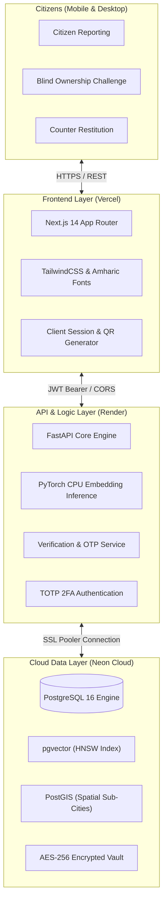

<div align="center">

# 🇪🇹 LIYUID — National Lost & Found Recovery Platform
### ልዩ መታወቂያ • AI-Assisted Property Recovery & Municipal Restitution System

[](https://liyuid-tau.vercel.app)
[](https://liyuid-backend.onrender.com/docs)
[](https://neon.tech)
[](https://github.com/binibiniyam2127-cell/liyuid/actions/workflows/ci.yml)
[](https://github.com/binibiniyam2127-cell/liyuid/actions/workflows/e2e-test.yml)
[](#)

<br/>

[**🌐 Live Citizen Portal**](https://liyuid-tau.vercel.app) • [**🏛️ Municipal Staff Portal**](https://liyuid-tau.vercel.app/staff/login) • [**📖 Interactive API Docs**](https://liyuid-backend.onrender.com/docs)

</div>

---

## 📌 Executive Overview

**LIYUID (ልዩ-ID)** is Ethiopia's national intelligent property recovery registry designed for metropolitan administrations (Addis Ababa Sub-Cities), university campuses, and civic transportation hubs. 

By combining **384-dimensional semantic vector embeddings (`pgvector`)**, **spatial geospatial boundaries (`PostGIS`)**, and a **Zero-PII blind challenge-response protocol**, LIYUID eliminates fraudulent claims, guarantees citizen privacy, and automates physical municipal vault custody.

---

## 🌟 Key Platform Features

### 1. 🤖 AI-Powered Zero-PII Semantic Matching
* **HNSW Vector Clustering:** Item descriptions are transformed into 384-dimensional vector embeddings (`all-MiniLM-L6-v2`) inside PostgreSQL using `pgvector`.
* **Cosine Decision Boundaries:** Auto-triages high-confidence matches ($\ge 0.85$), routes borderline matches ($0.65 - 0.84$) for human review, and auto-prunes low-confidence noise ($< 0.65$).
* **Zero PII Exposure:** Citizen phone numbers, full names, and sensitive identifiers are cryptographically masked and never exposed to finders or public search logs.

### 2. 🛡️ Blind-Sided Ownership Verification & Cryptographic Handover
Before physical contact is authorized, claimants must pass a strict blind challenge protocol:
1. **Zero-PII Blind Challenge:** Challenge endpoints never leak private truths, encrypted details, or hashes to public observers or potential impostors. Claimants must provide genuine private knowledge directly without multiple-choice distractors or quizzes.
2. **Deterministic Primary Proof:** Exact cryptographic comparison against hashed IMEI, serial numbers, or national ID last-4 digits.
3. **Anti-Brute Force Lockout Defense:** Strict 3-strike rate-limiting protects against enumeration; exceeding attempts locks the claim for administrative arbitration.
4. **Dynamic One-Time Password (OTP) & Dual Confirmation:** A cryptographic 6-digit release code is minted strictly for the verified owner. The finder and owner mutually confirm the exchange at handoff, completing the restitution lifecycle and logging immutable audit entries.

### 3. 🏛️ Municipal Vault Custody & Automated Restitution
* **Automated Shelf Tagging:** Drop-offs are assigned instant physical vault slots (e.g. `Locker B-14`, `Shelf C-03`) at sub-city desks.
* **Instant Citizen Notification:** Owners are immediately dispatched SMS and Telegram alerts upon municipal custody intake.
* **Dual QR Counter Verification:** Desk officers scan citizen QR dockets in under 0.2s and burn the 6-digit release OTP at the counter.

### 4. 👥 Multi-Desk Municipal Governance (Separation of Powers)
* **Cases Desk:** Routine intake, secure vault storage, counter handovers.
* **Disputes Desk:** Independent arbitration tribunal for contested claims and appeal reviews.
* **Flags Desk:** Cybersecurity threat triage (anti-Sybil bot defense, brute-force OTP blocks).
* **Reports Desk:** Immutable citywide audit ledger and tamper-evident CSV/JSON exports.

### 5. 🔐 Zero-Trust Staff Security
* **Argon2 Password Hashing:** State-of-the-art password security across all administrative accounts.
* **Mandatory 2FA (Google Authenticator):** Time-based One-Time Password (TOTP) enforcement on all municipal operations.

---

## 🏗️ System Architecture



---

## 📁 Repository Structure

```text
LIYUID/
├── liyuid-frontend/             # Next.js 14 Production Frontend (App Router, Tailwind)
│   ├── app/                     # Citizen portal & /staff municipal workbench
│   ├── components/              # Modular UI cards, modals, app-shell
│   ├── features/                # Domain features (api client, auth context & session)
│   ├── lib/                     # Types and bilingual dictionaries (Amharic/English)
│   └── vercel.json              # Vercel deployment configuration
│
├── liyuid-backend/              # FastAPI Production Backend Service
│   ├── alembic/                 # Database migration versions & baseline schema
│   ├── app/
│   │   ├── core/                # Config, security, session cookies, rate-limiting & audit
│   │   ├── routers/             # Domain endpoints (auth, reports, matches, handovers, staff, admin)
│   │   ├── services/            # State machines & business logic (verification, handover, staff)
│   │   ├── models/              # SQLAlchemy domain models (pgvector, PostGIS, JSONB)
│   │   ├── schemas/             # Pydantic v2 validation contracts
│   │   ├── database.py          # PostgreSQL session management with pool pre-ping
│   │   └── main.py              # Modular FastAPI orchestrator & lifespan startup
│   ├── docker/
│   │   └── init.sql             # Unified PostgreSQL schema (PostGIS + pgvector)
│   ├── tests/                   # Comprehensive test suite (34 passing tests)
│   └── requirements.txt         # Optimized CPU wheels & lightweight dependencies
│
├── liyuid-ai-worker/            # Asynchronous ML & Notification Worker Service
│   ├── tasks/                   # Celery tasks (embeddings, notifications, sanitization, DLQ)
│   ├── celery_app.py            # Celery distributed task queue configuration
│   ├── Dockerfile               # Standalone container for background ML worker
│   └── requirements.txt         # Celery, Redis & ML dependencies
│
├── liyuid-evaluation/           # AI Model Benchmarking & Testing Harness
│   ├── benchmark_eval.py        # Accuracy, recall, & cosine threshold evaluation
│   └── synthetic_data_generator.py # Test dataset generation for multilingual matching
│
├── test_e2e_http_lifecycle.py   # Full HTTP E2E Blind-Sided Verification Integration Test
├── invite_staff.py              # Interactive Municipal Staff Onboarding Tool (with QR)
├── Dockerfile.db                # Multi-stage PostgreSQL + PostGIS + pgvector Dockerfile
├── Dockerfile                   # Fail-safe root Dockerfile supporting Render & CI/CD
├── docker-compose.yml           # Local multi-service orchestration (FastAPI + Redis + Postgres + Worker)
└── README.md                    # Project documentation
```

### 🧠 The Role of `liyuid-ai-worker`
* **Distributed Asynchronous Execution:** In multi-container environments (and local Docker Compose), `liyuid-ai-worker` is powered by **Celery + Redis** to handle high-throughput background processing:
  * Generating 384-dimensional dense semantic vector embeddings (`all-MiniLM-L6-v2`).
  * Dispatching instant SMS (AfroMessage / Twilio) and Telegram Bot citizen notifications.
  * Performing periodic scheduled district custody reconciliations.
* **Unified Cloud Mode:** In free-tier cloud deployments (such as Render + Neon), PyTorch CPU inference and notifications run synchronously inside `liyuid-backend` to eliminate the cost of a standalone Redis broker and separate worker VM, preserving 100% feature parity.

---

## 🧪 Automated Testing & Continuous Integration

LIYUID features two automated testing suites executed continuously on GitHub Actions:

| Workflow Suite | Target Environment | Coverage |
| :--- | :--- | :--- |
| **Liyuid Test & Privacy CI** | Ubuntu Runner + PostgreSQL (`pgvector` + `PostGIS`) | **Unit & Security Tests:** Admin RBAC verification, Amharic Unicode NFC normalization, no self-match protection, 3-strike lockout, zero-PII schema contracts, and on-demand embedding search. |
| **Liyuid E2E Integration Suite** | Docker Compose (`postgres`, `redis`, `backend`, `worker`) | **Live HTTP Lifecycle:** Citizen registration, report creation, blind challenge privacy leak checks, lockout decrement tests, authentic proof verification, 6-digit dynamic OTP generation, dual-party handover confirmation, and PostgreSQL audit trail verification. |

To run the suites locally:
```bash
# Run backend pytest suite
PYTHONPATH=liyuid-backend:. python -m pytest liyuid-backend/tests/ -v

# Run live E2E HTTP integration test
python test_e2e_http_lifecycle.py
```

---

## 🚀 Quick Start (Local Development)

### Prerequisites
* **Python 3.11+**
* **Node.js 18+ & npm**
* **Docker & Docker Compose** (or local PostgreSQL with `pgvector` & `postgis`)

### 1. Multi-Container Orchestration (Docker Compose)
```bash
# Clone the repository
git clone https://github.com/binibiniyam2127-cell/liyuid.git
cd liyuid

# Build and start all services (PostgreSQL, Redis, Backend, Worker)
docker compose up -d --build
```
FastAPI Gateway will be live at `http://localhost:8000/docs`.

### 2. Manual Backend Setup
```bash
cd liyuid-backend

# Create virtual environment
python -m venv .venv
source .venv/bin/activate  # On Windows: .venv\Scripts\activate

# Install dependencies
pip install --extra-index-url https://download.pytorch.org/whl/cpu -r requirements.txt

# Start backend server
uvicorn app.main:app --reload --port 8000
```

### 3. Frontend Setup
```bash
cd liyuid-frontend

# Install dependencies
npm install

# Start development server
npm run dev
```
Frontend will be live at: `http://localhost:3000`

---

## 👮 Municipal Staff Onboarding

To onboard a new municipal desk officer or supervisor, run the interactive onboarding tool:

```powershell
python invite_staff.py
```

The script will guide you through:
1. Entering the **Staff ID Code** (e.g. `MUN-BOLE-03`)
2. Entering the **Officer Full Name** & **Official Email**
3. Selecting their **Desk Role** (`Cases Officer`, `Disputes Arbitrator`, `Security Officer`, etc.)
4. Assigning or auto-generating a secure initial password

### Instant Google Authenticator 2FA Setup
The tool generates an instant **QR Code Link**:
* The officer opens the link in their browser.
* Scans the QR code with **Google Authenticator** or **Microsoft Authenticator** on their phone.
* Logs in at `https://liyuid-tau.vercel.app/staff/login` with their 6-digit TOTP code.

To view all active staff members in the registry:
```powershell
python invite_staff.py --list
```

---

## 🔒 Security & Privacy Commitments

* **Zero-Credential Git Policy:** All production database secrets, API tokens, and private keys remain strictly outside version control.
* **AES-256 GCM Secret Encryption:** Private proof markers and 2FA secrets are encrypted at rest.
* **Non-Reversible TOTP Security:** Staff authentication enforces RFC 6238 time-synchronized 6-digit tokens.
* **Role-Based Least Privilege:** Officers can only access desks aligned with their assigned jurisdiction and responsibilities.

---

## 📄 License & Attribution

Designed and engineered for national property recovery and civic governance in Ethiopia.  
**City Administration of Addis Ababa • Sub-City Restitution Stations • LIYUID Core Team**
